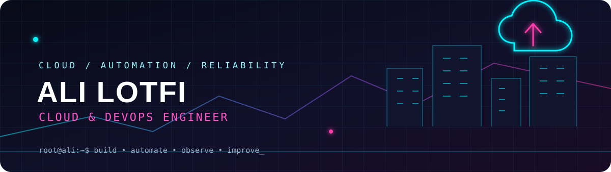

  

<h1 align="center">Hi, I'm Ali Lotfi 👋</h1>

  <strong>Cloud &amp; DevOps Engineer</strong> 
  Infrastructure · Automation · Cloud-Native Systems · Observability

  
  
  

---

## whoami

I'm a Cloud &amp; DevOps-focused engineer interested in building reliable infrastructure, automating delivery workflows, and making systems observable and maintainable.

I'm currently pursuing an **M.Sc. in Applied Computer Science at the University of Bamberg, Germany**. My hands-on work and projects span Linux administration, CI/CD, container platforms, infrastructure as code, cloud tooling, and monitoring.

I enjoy understanding systems from the infrastructure layer up — then turning that understanding into practical tools and repeatable automation.

## Current focus

- **Cloud &amp; infrastructure:** Linux, networking, virtualization, and cloud platforms
- **Containers &amp; orchestration:** Docker and Kubernetes
- **Infrastructure as Code:** Terraform, Ansible, and configuration automation
- **CI/CD:** Jenkins, pipeline automation, and deployment workflows
- **Observability:** Prometheus, Grafana, Loki, and monitoring systems
- **Engineering:** Go, Python, Bash, APIs, and automation tools

## Featured projects

A selection of projects from my repositories:

| Project | What it explores |
|---|---|
| [**aws-solution-architect**](https://github.com/alilotfi23/aws-solution-architect) | Terraform configurations for AWS infrastructure and services |
| [**Terraform-JCasC-K8s**](https://github.com/alilotfi23/Terraform-JCasC-K8s) | Jenkins Configuration as Code on Kubernetes with Helm and Terraform |
| [**jenkins-K8s**](https://github.com/alilotfi23/jenkins-K8s) | Jenkins CI/CD deployment on a Kubernetes cluster |
| [**observability-stack**](https://github.com/alilotfi23/observability-stack) | A Docker Compose monitoring and logging stack with Prometheus, Loki, and Grafana |
| [**DockManager-API**](https://github.com/alilotfi23/DockManager-API) | Docker management API with authentication, resource operations, and live container telemetry |
| [**LVM-Manager-TUI**](https://github.com/alilotfi23/LVM-Manager-TUI) | Go-based terminal UI for inspecting and managing Linux LVM |
| [**OpenIPAM**](https://github.com/alilotfi23/OpenIPAM) | Self-hosted IP address management platform with API-driven automation |

## Tech stack

  
  
  
  
  
  
  
  
  
  
  
  

## Connect

I'm always interested in exchanging ideas about cloud infrastructure, DevOps practices, Linux, automation, and cloud-native engineering.

  

  Build it. Automate it. Observe it. Make it reliable.

